<p align="center">
    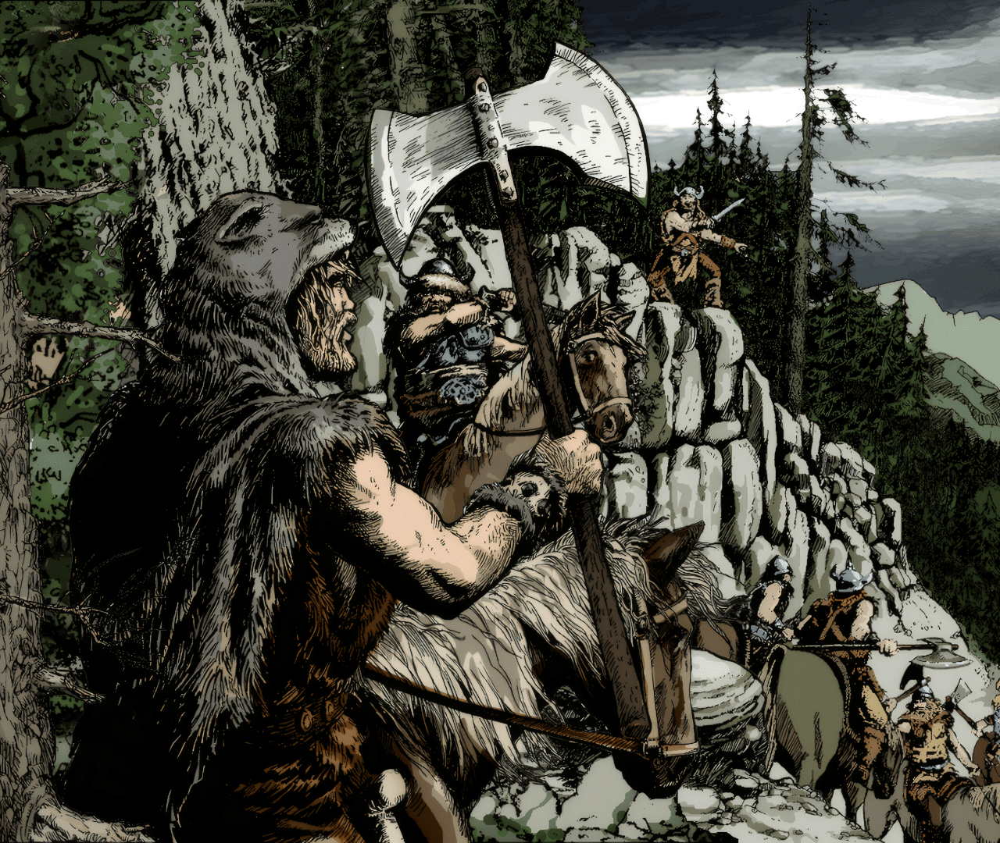
    <br>
    <b>Imperivm 1 - La Amenaza Teutón</b>
</p>

**Imperivm 1 HD** es un **mod** («La Amenaza Teutón») y un **parche Full HD** para *Imperivm - La Guerra de las Galias* (Celtic Kings / Imperivm 1). Añade nuevas **resoluciones HD** hasta 1920×1080, una **IA mejorada**, cambios en unidades, mapas aleatorios, **soporte multi idioma** (Español, Alemán, Francés, Inglés e Italiano) y soporte para jugar en **Linux/Wine**.

## Descargar

[Descargar el mod](https://github.com/JosueCA/La-Amenaza-Teuton/releases)  

[Descargar Imperivm 1 HD (Sin mod)](https://github.com/JosueCA/La-Amenaza-Teuton/releases)  

[Descargar mapas](https://github.com/JosueCA/La-Amenaza-Teuton)  

[Descargar en Moddb](https://www.moddb.com/mods/la-amenaza-teuton)  

### Notas de Instalación

Este MOD se aplica directamente sobre la instalación del juego de "Imperivm 1: La Guerra de las Galias" (versión española de Celtic Kings: Rage of War). Reemplazando los archivos .pak y demás directorios/ficheros incluidos en el zip.

---


## Compatibilidad con aventuras
Este MOD no es 100% compatible con las aventuras. Para disfrutar de la experiencia original en Full HD, utilizar el parche independiente para el juego.

[Compatibilidad aventuras](https://github.com/JosueCA/La-Amenaza-Teuton/blob/master/AdventuresMod/README.md)

## Tabla de Contenidos

1. [Compatibilidad Wine](#1-compatibilidad-wine)
1. [Nuevas resoluciones HD de pantalla](#2-nuevas-resoluciones-hd-de-pantalla)
1. [Soporte multilingüe](#3-soporte-multilingüe)
1. [Cambios generales](#4-cambios-generales)
1. [Mapas aleatorios](#5-mapas-aleatorios)
1. [Cambios en Unidades](#6-cambios-en-unidades)
   - [Especialidades](#especialidades)
   - [Efectos visuales de las especialidades](#efectos-visuales-de-las-especialidades)
   - [Unidades Galas](#unidades-galas)
   - [Unidades Romanas](#unidades-romanas)
   - [Unidades Teutón](#unidades-teutón)
   - [Otras Unidades](#otras-unidades)
   - [Héroes](#héroes)
1. [Mejoras al juego](#7-mejoras-al-juego)
   - [Nueva IA «LAT»](#nueva-ia-lat)
   - [Fortaleza](#fortaleza)
   - [Taverna Romana](#taverna-romana)
   - [Eliminado 'entrenamiento' de las unidades](#eliminado-entrenamiento-de-las-unidades)
   - [Formaciones](#formaciones)
   - [Druidas y Magia](#druidas-y-magia)
   - [Teutones](#teutones)
   - [Catapultas](#catapultas)
   - [Aldeas](#aldeas)
   - [Fortines](#fortines)
   - [Animales](#animales)
   - [Otros](#otros)
1. [Correcciones al bioma de invierno](#8-correcciones-al-bioma-de-invierno)
1. [Colores de Jugadores](#9-colores-de-jugadores)

---

## 1. Compatibilidad Wine
- **Wine**: WinXP 32 bits
- **Winetricks**
```
dmband
dmcompos
dmime
dmloader
dmscript
dmstyle
dmsynth
dmusic
dmusic32
dsound
dswave
directmusic
```

- **Conversión de codec de audio**: Los archivos de voz de las unidades usaban el codec Microsoft ADPCM, que Wine no soporta completamente. Se convirtieron **120+ archivos WAV** de voces (galos, romanos y teutones) a PCM estándar para que funcionen correctamente en Linux/Wine.
- Convertidos archivos de audio de las aventuras 'Celtic Kings Adventure' y 'Tutorial'

## 2. Nuevas resoluciones HD de pantalla

| Resolución | Ancho | Alto | Aspecto |
|------------|-------|------|---------|
| Res1 | 1024 | 768 | 4:3 |
| Res2 | 1152 | 864 | 4:3 |
| Res3 | 1280 | 720 | 16:9 |
| Res4 | 1280 | 800 | 16:10 |
| Res5 | 1280 | 1024 | 5:4 |
| Res6 | 1360 | 768 | 16:9 |
| Res7 | 1366 | 768 | 16:9 |
| Res8 | 1400 | 1050 | 4:3 |
| Res9 | 1440 | 900 | 16:10 |
| Res10 | 1600 | 900 | 16:9 |
| Res11 | 1600 | 1024 | 25:16 |
| Res12 | 1600 | 1050 | 32:21 |
| Res13 | 1600 | 1200 | 4:3 |
| Res14 | 1600 | 1280 | 5:4 |
| Res15 | 1680 | 1050 | 16:10 |
| Res16 | 1920 | 1080 | 16:9 |
| Res17 | 1920 | 1200 | 16:10 |

**Soporte para resoluciones 1600px-1920px disponible desde la versión "La Amenaza Teuton v0.4.0"**

## 3. Soporte multilingüe
- Añadidos idiomas Alemán, Francés, Inglés, e Italiano (además del Español). Configurable desde el fichero 'vxSettings.ini'
- Corregido volumen de las voces en inglés

## 4. Cambios generales
- Cambios en la música
- Pequeños ajustes en la interfaz del juego
- Vídeo introductorio reemplazado por el trailer (mejor calidad)
- Mejorada estabilidad del juego
- La barra de vida de las unidades (función activada con la tecla '~') se ha limitado a los Héroes. Limitado a las unidades del jugador

<p align="center">
    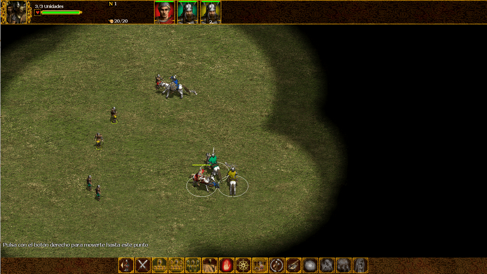
</p>

- Nuevo tipo de partida 'Total war' (Eliminación, pero con reclutamiento multiplicado x5)

## 5. Mapas aleatorios
- Modificada generación de mapas aleatoria
- Reutilizados assets para generar decorados más variados
- Aumentado el ratio de decoraciones
- Añadidos más decorados que generan items
- Disminuido número de ciervos
- Nuevos decorados para aldeas, fortalezas, fortínes y campamentos teutones
- Mejorada colocación aleatoria de montañas sobre las aldeas

<span id="galeria"></span>

<div class="galeria" markdown="0">
  <a href="#img-decorados1">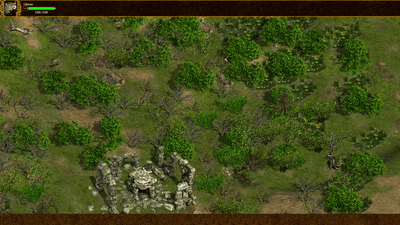</a>
  <a href="#img-decorados2">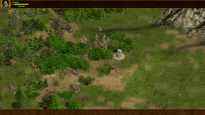</a>
  <a href="#img-romecity">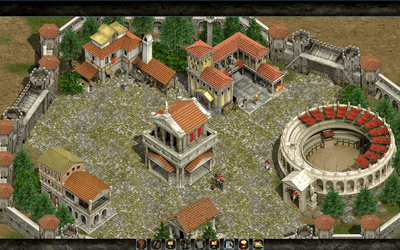</a>
  <a href="#img-gaulcity">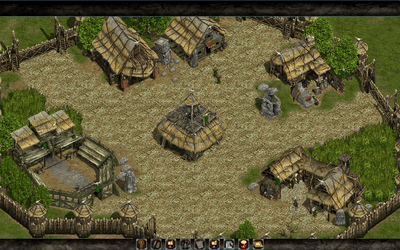</a>
  <a href="#img-outpost1">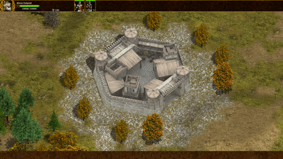</a>
  <a href="#img-outpost2">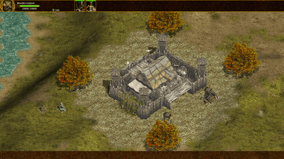</a>
  <a href="#img-village1">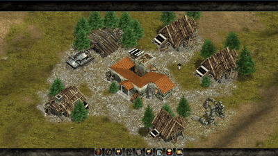</a>
  <a href="#img-village2">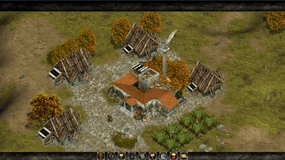</a>
  <a href="#img-village3">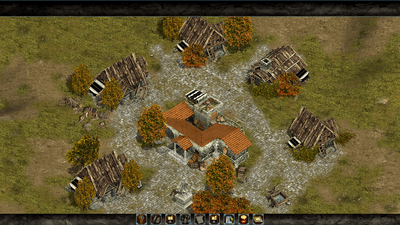</a>
  <a href="#img-village4">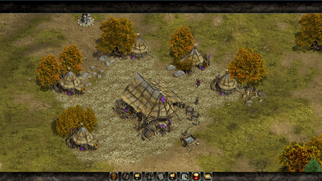</a>
  <a href="#img-village5">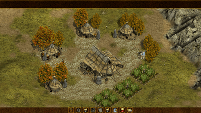</a>
  <a href="#img-village6">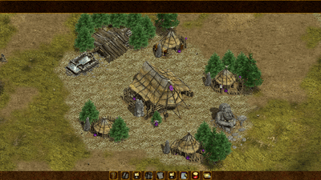</a>
</div>

<div class="lightbox" id="img-decorados1"><a href="#galeria" class="cerrar">&times;</a>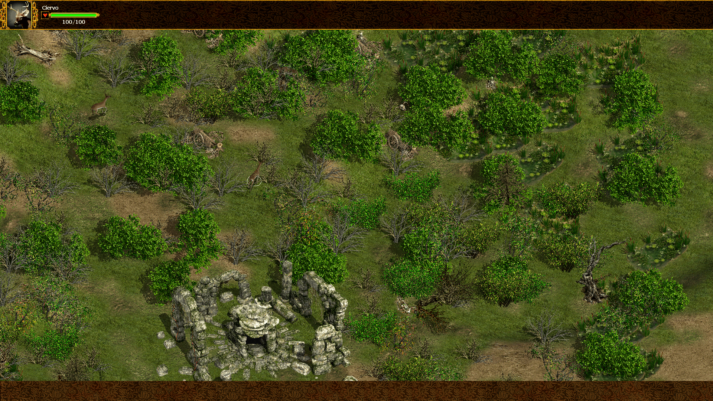</div>
<div class="lightbox" id="img-decorados2"><a href="#galeria" class="cerrar">&times;</a></div>
<div class="lightbox" id="img-romecity"><a href="#galeria" class="cerrar">&times;</a>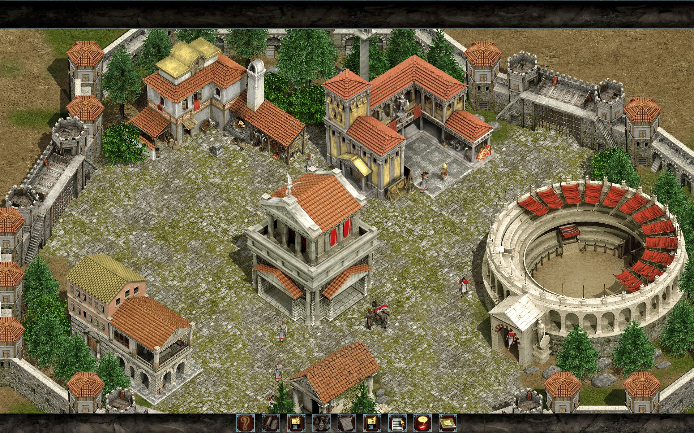</div>
<div class="lightbox" id="img-gaulcity"><a href="#galeria" class="cerrar">&times;</a></div>
<div class="lightbox" id="img-outpost1"><a href="#galeria" class="cerrar">&times;</a></div>
<div class="lightbox" id="img-outpost2"><a href="#galeria" class="cerrar">&times;</a>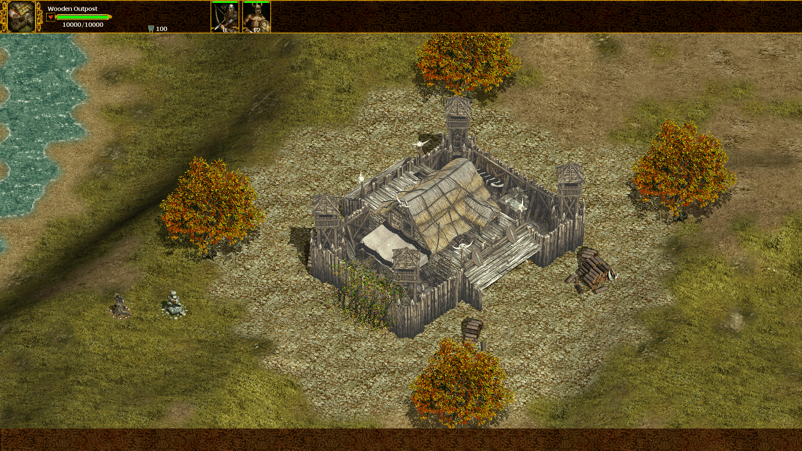</div>
<div class="lightbox" id="img-village1"><a href="#galeria" class="cerrar">&times;</a></div>
<div class="lightbox" id="img-village2"><a href="#galeria" class="cerrar">&times;</a></div>
<div class="lightbox" id="img-village3"><a href="#galeria" class="cerrar">&times;</a>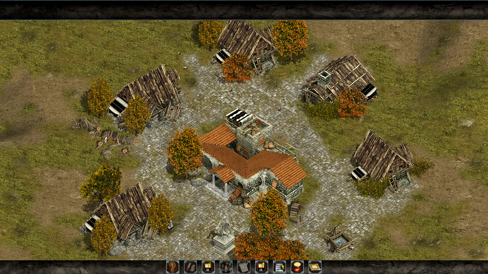</div>
<div class="lightbox" id="img-village4"><a href="#galeria" class="cerrar">&times;</a></div>
<div class="lightbox" id="img-village5"><a href="#galeria" class="cerrar">&times;</a>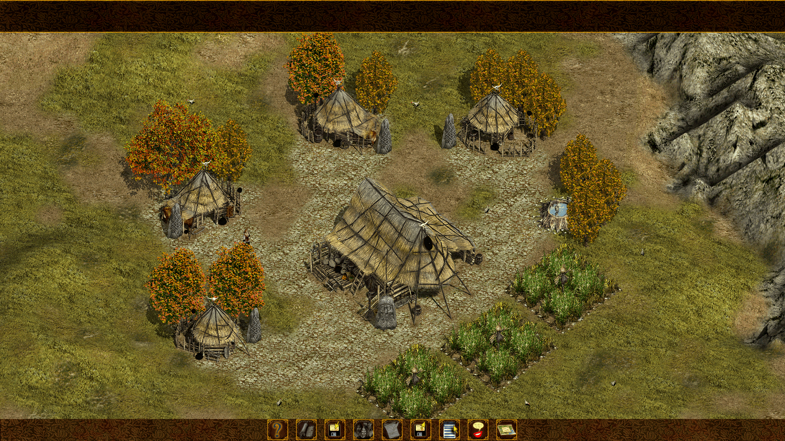</div>
<div class="lightbox" id="img-village6"><a href="#galeria" class="cerrar">&times;</a>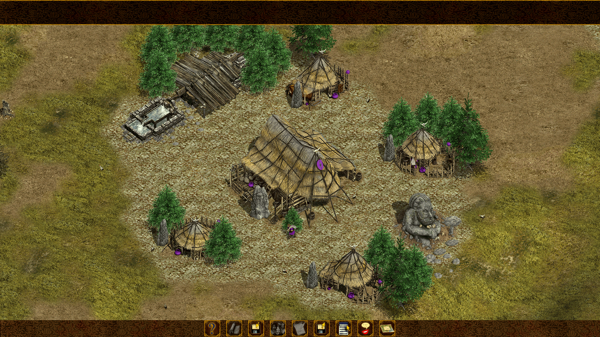</div>

---

## 6. Cambios en Unidades

## Especialidades

- La especialidad 'golpe letal/death blow' no afecta a los héroes
- Corregida especialidad 'attack skill' que no funcionaba

| Especialidad | Valor | Descripción |
|---|---|---|
| `ataque continuo/attack skill` | +1 | Aumenta el daño con cada golpe contra el mismo objetivo |
| `berserk/berserker` | 100 % | Aumenta el daño al perder salud |
| `carga/charge` | 600 % / 8 000 ms | Multiplica el daño por 600% con una recarga de 8 segundos sin atacar |
| `daño conjunto/trample damage` | 50 % | La unidad inflige un 50 % de daño a los enemigos cercanos |
| `daño expansivo/spread damage` | 175 % | El daño aumenta cuanto más dañado esté el objetivo |
| `daño reflejado/spike damage` | 25 % | Devuelve 25% del daño al atacante. |
| `golpe del vampiro/vampire blow` | 33 % | Recupera el 33 % del daño infligido como salud propia. |
| `golpe letal/death blow` | 33 % | Cuando el objetivo tiene menos del 33% de vida el siguiente ataque lo mata de un golpe. |
| `libertad/freedom` | — | No permite unirse a los héroes. |
| `posición defensiva/defensive stand` | — | Resiste el primer golpe del atacante |

---

## Efectos visuales de las especialidades

| Especialidad | Efecto | Se muestra sobre | Cuándo aparece |
|---|---|---|---|
| `ataque continuo/attack skill` |  | Atacante | En cada golpe |
| `berserk/berserker` |  | Atacante | En cada golpe |
| `carga/charge` |  | Atacante | **Solo** cuando la carga está recargada |
| `daño conjunto/trample damage` |  | Atacante | En cada golpe |
| `daño expansivo/spread damage` |  | Objetivo | En cada golpe |
| `daño reflejado/spike damage` |  | Defensor | En cada golpe |
| `golpe del vampiro/vampire blow` |  | Atacante | En cada golpe |
| `golpe letal/death blow` |  | Objetivo | **Solo** en el golpe que remata |
| `posición defensiva/defensive stand` |  | Defensor | **Solo** en el primer golpe del atacante |

`libertad/freedom` es una habilidad pasiva y no tiene efecto visual.

---

## Unidades Galas

| Unidad | Salud | Ataque | Tipo de ataque | Def. Corte | Def. Pierce | Velocidad | Rango | Especialidad |
|---|---|---|---|---|---|---|---|---|
| <span class="unidad">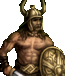<span>Guerrero</span></span> | 160 | 10–18 | slash | 0 | 0 | 100 | — | — |
| <span class="unidad">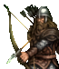<span>Arquero</span></span> | 100 | 6–10 | pierce | 0 | 0 | 80 | 400 | daño expansivo |
| <span class="unidad">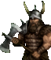<span>Guerrero con hacha</span></span> | 280 | 16–24 | slash | 2 | 0 | 80 | — | daño conjunto |
| <span class="unidad">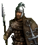<span>Lancero</span></span> | 300 | 16–24, x1.5 vs Caballería | pierce | 6 | 6 | 80 | — | posición defensiva, daño expansivo |
| <span class="unidad">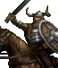<span>Jinete</span></span> | 380 | 20–28 | slash | 0 | 0 | 140 | — | carga |
| <span class="unidad">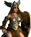<span>Mujer guerrera</span></span> | 340 | 18–36 | slash | 0 | 8 | 80 | — | golpe del vampiro |
| <span class="unidad"><span>Druida</span></span> | 120 | — | — | — | — | 60 | 200 | — |
| <span class="unidad">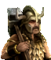<span>Jefe Normando</span></span> | 3000 | 42–84 | slash | 6 | 6 | 80 | — | libertad, carga |
| <span class="unidad">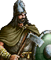<span>Guardia de élite</span></span> | 350 | 18–28 | slash | 10 | 10 | 80 | — | posición defensiva, ataque continuo |

---

## Unidades Romanas

| Unidad | Salud | Ataque | Tipo de ataque | Def. Corte | Def. Pierce | Velocidad | Rango | Especialidad |
|---|---|---|---|---|---|---|---|---|
| <span class="unidad">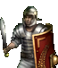<span>Legionario</span></span> | 200 | 13–17 | slash | 0 | 5 | 80 | — | posición defensiva |
| <span class="unidad">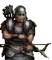<span>Arquero</span></span> | 125 | 9–13 | pierce | 3 | 3 | 80 | 400 | daño expansivo |
| <span class="unidad">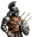<span>Gladiador</span></span> | 255 | 21–21 | pierce | 5 | 0 | 100 | — | daño expansivo |
| <span class="unidad">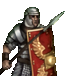<span>Princep</span></span> | 275 | 15–23, x1.5 vs Caballería | slash | 7 | 15 | 80 | — | posición defensiva, daño reflejado |
| <span class="unidad">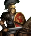<span>Equite</span></span> | 330 | 17–25 | slash | 3 | 3 | 140 | — | carga |
| <span class="unidad">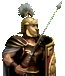<span>Pretoriano</span></span> | 475 | 27–47 | pierce | 7 | 7 | 80 | — | ataque continuo, golpe letal |
| <span class="unidad"><span>Sacerdote</span></span> | 120 | — | — | — | — | 60 | 200 | — |
| <span class="unidad">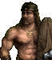<span>Liberati</span></span> | 300 | 30–30 | slash | 0 | 0 | 120 | — | berserker |
| <span class="unidad"><span>Elefante de guerra</span></span> | 2000 | 30–40 | slash | 10 | 10 | 60 | — | libertad, daño conjunto |

### Elefante de guerra
- Las unidades a distancia infligen x1.5 contra Elefantes de guerra

---

## Unidades Teutón

| Unidad | Salud | Ataque | Tipo de ataque | Def. Corte | Def. Pierce | Velocidad | Rango | Especialidad |
|---|---|---|---|---|---|---|---|---|
| <span class="unidad">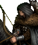<span>Arquero Teutón</span></span> | 200 | 8–18, x2 vs Mulas | pierce | 0 | 0 | 160 | 400 | — |
| <span class="unidad">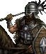<span>Jinete Teutón</span></span> | 250 | 10–20, x2 vs Mulas | slash | 0 | 0 | 160 | — | daño conjunto |
| <span class="unidad"><span>Arquero Galo Teutón</span></span> | 100 | 6–12 | pierce | 2 | 2 | 80 | 400 | — |
| <span class="unidad"><span>Espadachín Galo Teutón</span></span> | 240 | 10–18 | slash | 2 | 2 | 100 | — | — |
| <span class="unidad"><span>Arquero Romano Teutón</span></span> | 125 | 9–13 | pierce | 3 | 3 | 80 | 400 | — |
| <span class="unidad"><span>Hastatus Romano Teutón</span></span> | 240 | 13–17 | slash | 3 | 3 | 80 | — | — |

### Arquero teutón
- Configurada la animación 'taunt' de la unidad

---

## Otras Unidades

| Unidad | Salud | Ataque | Tipo de ataque | Def. Corte | Def. Pierce | Velocidad | Rango | Especialidad |
|---|---|---|---|---|---|---|---|---|
| <span class="unidad">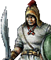<span>Miliciano</span></span> | 180 | 6–12 | slash | 4 | 0 | 80 | — | — |
| <span class="unidad">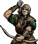<span>Arquero</span></span> | 180 | 12–18 | pierce | 4 | 8 | 80 | 400 | — |
| <span class="unidad"><span>Hondero</span></span> | 200 | 20–30 | pierce | 0 | 0 | 100 | 300 | — |
| <span class="unidad">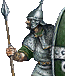<span>Defensor</span></span> | 200 | 14–24 | pierce | 8 | 8 | 80 | — | posición defensiva |
| <span class="unidad">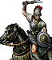<span>Caballería</span></span> | 240 | 20–30 | slash | 6 | 6 | 160 | — | carga |
| <span class="unidad">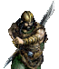<span>Montañés</span></span> | 400 | 24–48 | slash | 4 | 0 | 80 | — | libertad |

---

### Héroes
- Modificaciones en las estadísticas base de héroes (más vida)
- Más vida por nivel
- Reutilizados assets de héroes para generar más héroes aleatorios
<p align="center">
    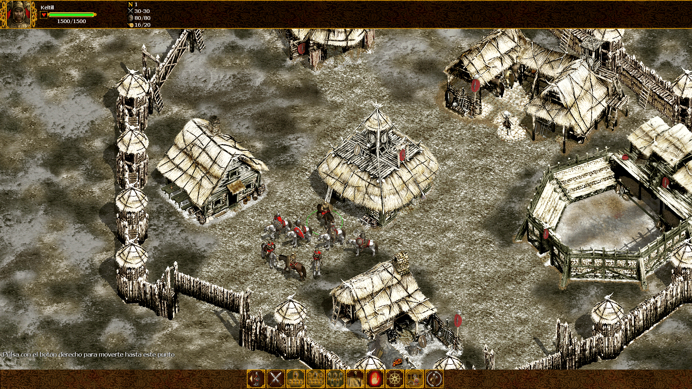
</p>

- Los héroes pueden ordenar a los Druidas/Sacerdotes asignados a lanzar sus hechizos
- Los héroes pueden ordenar a sus unidades construir una catapulta
- NOTA: dar una nueva orden desde los héroes, cancela la orden anterior de catapulta/hechizos
<p align="center">
    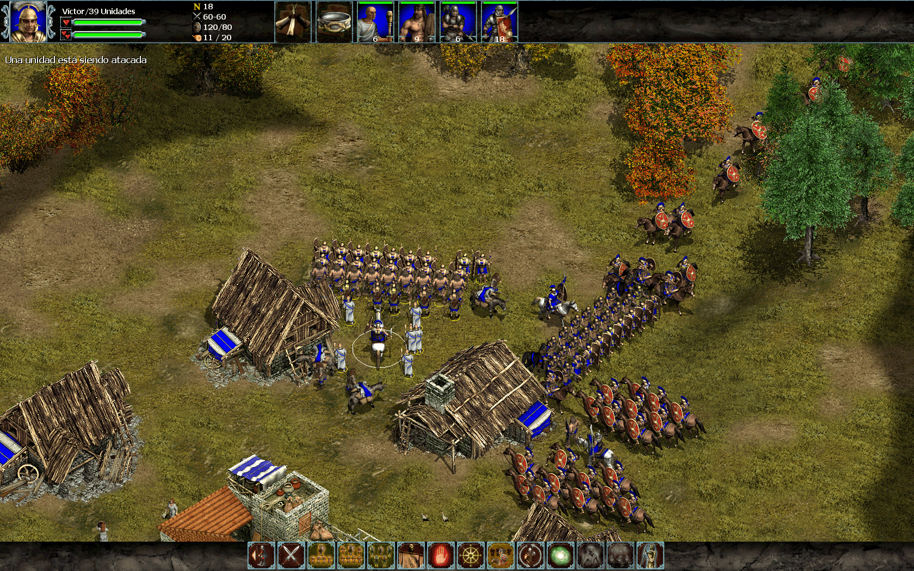
</p>

- Modificado el reclutamiento aleatorio de los héroes, ahora es secuencial con el inicio aleatorio, para maximizar la distinción entre los assets/sprites de cada héroe en la partida.

## 7. Mejoras al juego

### Nueva IA «LAT»
- Mayor dificultad al jugar contra la IA
- Añadida una estrategia militar inicial
- Añadida una estrategia de exploración inicial
- Corregidos casos específicos en el algoritmo de asedio que mantenía a los ejércitos atascados sin poder asediar la fortaleza enemiga
- Mejorado algoritmo de investigación de tecnologías. La IA investiga las mejoras en el coliseo, taberna, templo
- Mejorado reclutamiento de las unidades especiales
- Mejorado reclutamiento de las unidades militares
- Mejorado cálculo y respuesta a las amenazas
- Mejorada gestión de objetivos, IA más agresiva
- Mejorado sistema de monitoreo y control de ejércitos
- Mejorada el sistema de retirada de los ejércitos
- Mejorado sistema de suministros de comida de los ejércitos
- Mejorado sistema de teletransporte (cuevas)
- Mejorado el uso de las ruinas
- Mejorado el sistema de recogida y uso de items  
- Reimplementado comercio de comida con los outpost galos
<p align="center">
    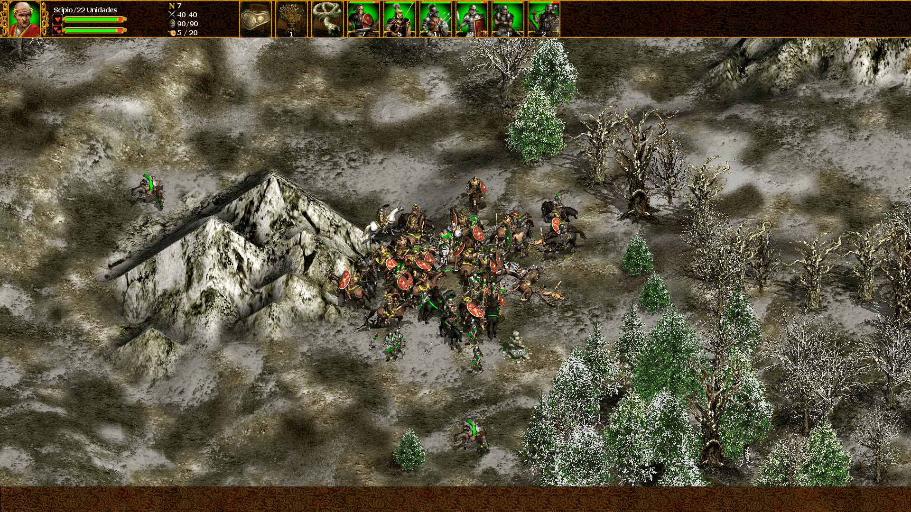
</p>

### Fortaleza
- Corregidas animaciones de campesinos en las fortalezas romanas, además de añadir los edificios faltantes
- Añadidos legionario (Roma)/arquero galo (Galo) a las animaciones de campesinos
- Ajustados parámetros de ataque de torres y puertas. Las puertas también disparan flechas.
- Añadida notificación cuando termina la investigación de una tecnología
- Desde el foro se pueden ejecutar los hechizos de los altares (el altar se elige aleatoriamente)
<p align="center">
    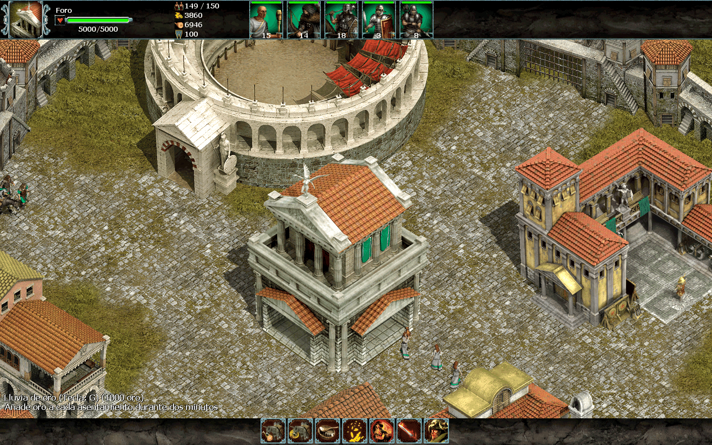
</p>

### Taverna Romana
- Nueva tecnología 'Campeonatos'
- Modificada tecnología 'Importar caballos'

### Eliminado 'entrenamiento' de las unidades
- Las unidades del cuartel se generan con el nivel de 'entrenamiento' investigado
<p align="center">
    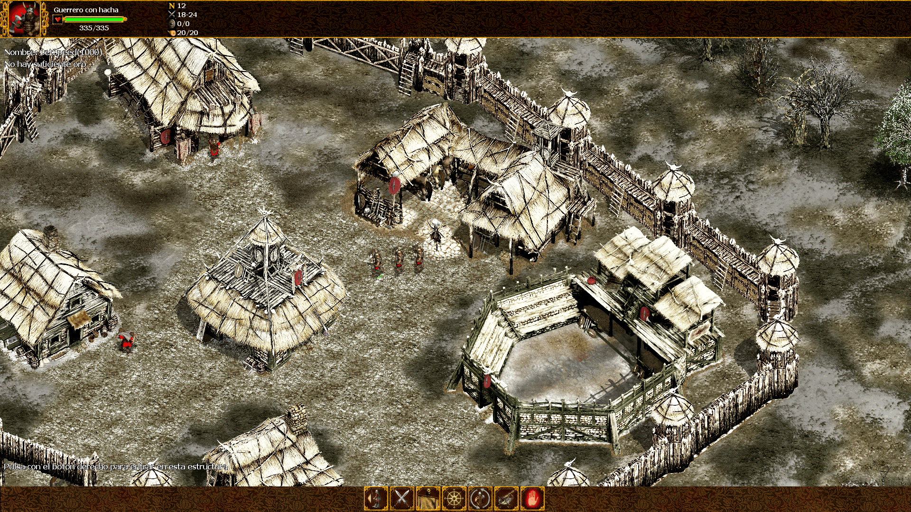
</p>

### Formaciones
- Reducido el 'radio' de las unidades en formación. Las unidades en formaciones están más cerca entre sí.
- Modificadas estructuras de las formaciones
<p align="center">
    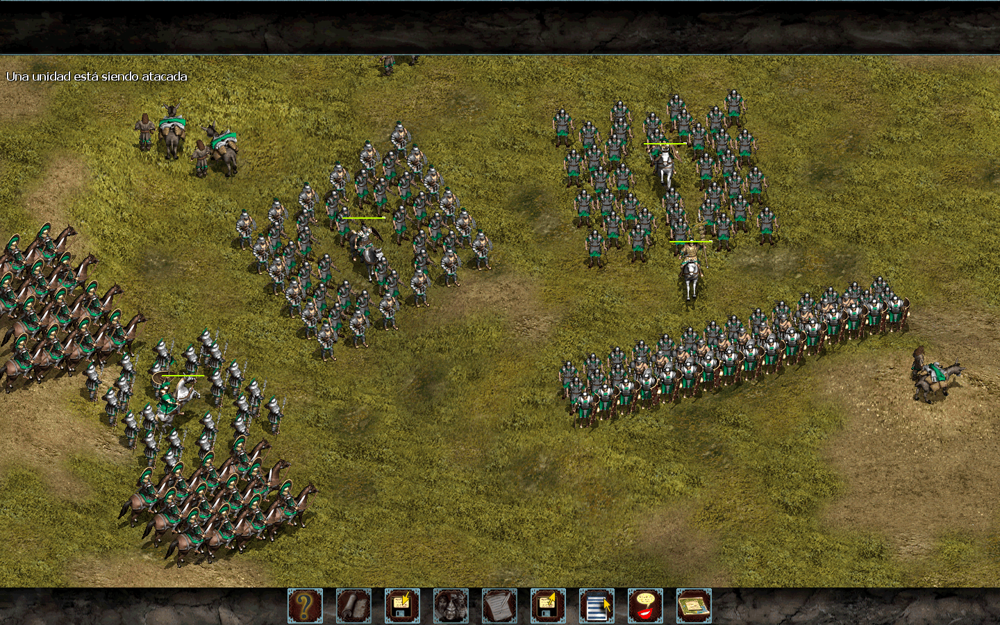
</p>

### Druidas y Magia
- Reducido daño de los hechizos
- Reimplementada la 'Nube Venenosa' (sacerdote) para que no dañe a unidades amigas
- Ajustes al sistema de reclutamiento de druidas
- La IA utiliza los altares durante las partidas aleatorias
- La IA utiliza los hechizos en el combate (Espíritu Vampiro, Nube venenosa)
<p align="center">
    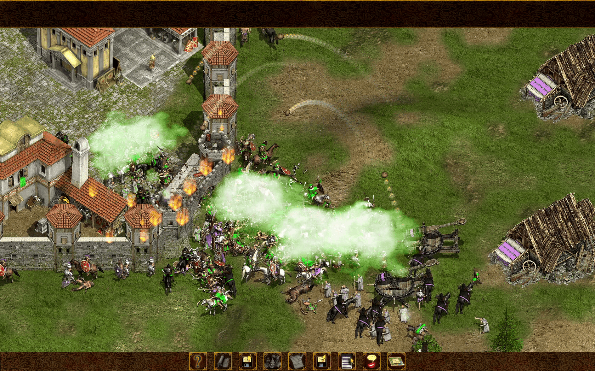
</p>

### Teutones
- Mejorada IA de los ejércitos teutones
- Los Teutones pueden capturar fortalezas de los jugadores
<p align="center">
    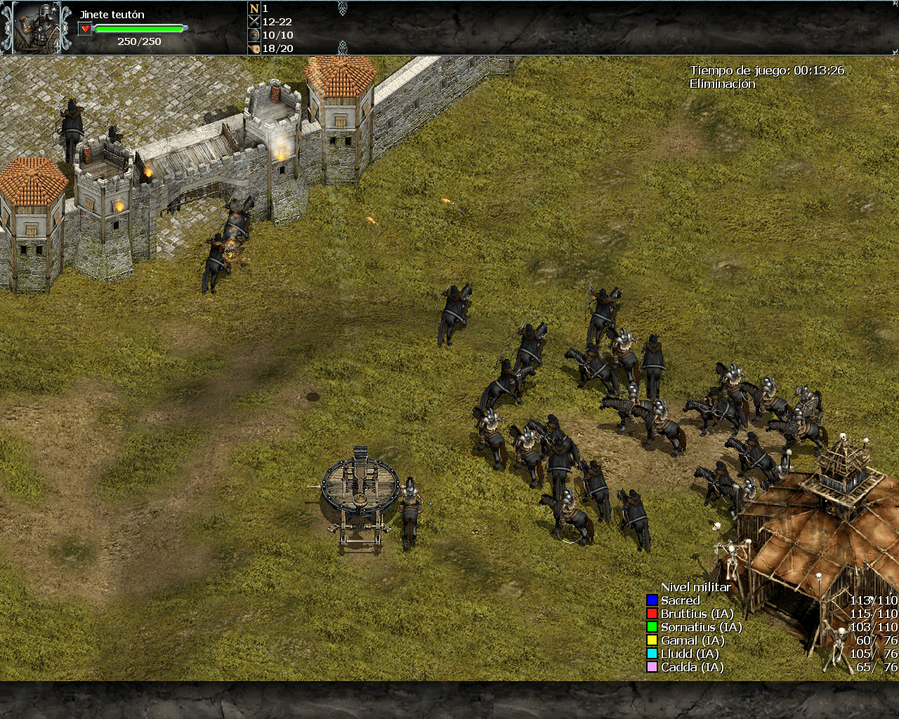
</p>

### Catapultas
- Reducido límite de unidades de 10 a 5

### Aldeas
- Las aldeas producen campesinos automáticamente junto a las mulas de comida
- Corregido bug de campesinos/mulas atascados para siempre en las puertas de la fortaleza
- Mejorada captura de las aldeas, no es posible capturar la aldea capturando sus 'casas'

### Fortines
- Añadidos defensores iniciales a los fortines
<p align="center">
    
</p>
<p align="center">
    
</p>


### Animales
- Corregido bug de los ciervos atascados en los bordes del mapa

### Otros
- Corregidos mensajes 'Handle Leak' en el vx.log
- Corregidos mensajes 'assets/interface/settlement icon' en vx.log
- Corregidos BONUS.XML que no tienen efecto aleatoriamente
- Corregidos crashes aleatorios al cargar mapas

## 8. Correcciones al bioma de invierno
- Reemplazadas las imágenes de los minimap por las de verano
- Reducida la exposición (brillo) de las texturas de terreno de invierno
<p align="center">
    
</p>
<p align="center">
    
</p>


## 9. Colores de Jugadores

Rediseño de los colores de los jugadores para maximizar la distinción visual entre ellos y evitar interferencias.

| ID    | Color original | HEX original | Color nuevo | HEX nuevo  |
|-------|---------------|--------------|-------------|------------|
| id1   |  | `#FF1717` |  | `#FF2222` |
| id2   |  | `#FFFF00` |  | `#CCBB00` |
| id3   |  | `#00FF00` |  | `#00BB77` |
| id4   |  | `#00E8E8` |  | `#00E8E8` |
| id5   |  | `#EDA0FF` |  | `#007700` |
| id6   |  | `#B6E686` |  | `#9900CC` |
| id7   |  | `#AE0000` |  | `#FF8800` |
| id8   |  | `#F99B20` |  | `#66AA00` |
| id9   |  | `#109B12` |  | `#0099CC` |
| id10  |  | `#0000F8` |  | `#555555` |
| id11  |  | `#C40DC6` |  | `#FF44CC` |
| id12  |  | `#9F9A00` |  | `#CC0055` |
| id13  |  | `#808080` |  | `#111111` |


## Y muchos más cambios sin documentar...
